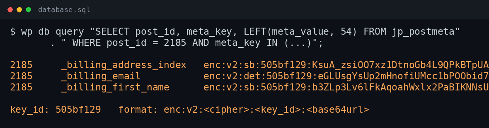

# Encrypted Fields

[](https://github.com/thiennhant95/wp-encrypted-fields/actions/workflows/ci.yml)
[](LICENSE)
[](https://www.php.net/)
[](https://thiennhant95.github.io/wp-encrypted-fields/)

Registry-driven, field-level encryption for WordPress and WooCommerce.

Encrypt only the fields you declare, keep normal WordPress APIs working, and
search encrypted identifiers through blind indexes. Keys live outside the
database; no core or third-party plugin patches are required.

**Website:** [English](https://thiennhant95.github.io/wp-encrypted-fields/) ·
[Tiếng Việt](https://thiennhant95.github.io/wp-encrypted-fields/vi/)

[](https://thiennhant95.github.io/wp-encrypted-fields/#evidence)

## Features

- Transparent encryption/decryption for post, user, term and comment meta.
- `wp_users.user_login` and `user_email` blind-index token mode (no column
  overflow, plaintext stored encrypted in user meta).
- Exact and partial search through HMAC token indexes (no plaintext stored).
- `get_user_by()`, `email_exists()`, `username_exists()` and raw `=`/`IN`
  lookups keep working.
- Mail recipients are decrypted automatically; optional body token replacement.
- Password-reset messages resolve token values.
- Registry can be defined in `wp-config.php`, a config file, a filter, or the
  admin UI; unlisted fields are never encrypted (default deny).
- Optional WooCommerce integration (order meta, order search, analytics
  customer lookup, customer objects). HPOS must be disabled in v1.
- Optional SiteGuard integration.
- Key rotation via a safe two-phase `KEC_KEY_NEXT`.
- Setup wizard for new and existing sites, with a mandatory backup gate.
- WP-CLI commands for status, scan, migrate, decrypt, reindex, verify and
  rotation.
- Legacy cipher adapter for migration from the original Koyo implementation.

## Requirements

- PHP 8.0+ (8.3 recommended)
- WordPress 6.4+
- OpenSSL extension (required); Sodium is optional
- WooCommerce is optional

## Installation

1. Copy this directory to `wp-content/plugins/wp-encrypted-fields`.
2. Activate **Encrypted Fields** in WordPress.
3. Define a key and a field registry (see below).
4. Open **Settings → Encrypted Fields** and complete the setup wizard.

Do not use the plugin without a key. Existing data must be backed up before
migration; the wizard enforces this.

## Quick start

Add to `wp-config.php` (before `require_once ABSPATH . 'wp-settings.php';`):

```php
define('KEC_KEY', 'base64:REPLACE_WITH_32_BYTE_KEY');
define('KEC_TOKEN_SECRET', 'base64:REPLACE_WITH_A_STABLE_SECRET');

define('KEC_FIELDS', [
    'user' => [
        'columns' => [
            'user_login' => ['type' => 'login', 'max_length' => 60],
            'user_email' => ['type' => 'email', 'max_length' => 100],
        ],
        'meta' => [
            'billing_first_name' => ['type' => 'text', 'search' => true],
            'billing_email'      => ['type' => 'email', 'search' => true],
        ],
    ],
    'post' => [
        'post_types' => ['shop_order'],
        'meta' => [
            '_billing_first_name' => ['type' => 'text', 'search' => true],
            '_billing_email'      => ['type' => 'email', 'search' => true],
            '_billing_address_index'  => ['type' => 'text', 'search' => true],
            '_shipping_address_index' => ['type' => 'text', 'search' => true],
        ],
    ],
]);
```

Generate a key:

```bash
wp kec key generate
```

Then run the wizard or:

```bash
wp kec scan
wp kec migrate --backup-confirmed --dry-run
wp kec migrate --backup-confirmed
wp kec verify
```

## Configuration

See [docs/configuration.md](docs/configuration.md) for the registry format,
field types and every supported constant.

## CLI

See [docs/cli.md](docs/cli.md).

## Migration

See [docs/migration.md](docs/migration.md) for plaintext/legacy migration,
auxiliary tables (`wc_customer_lookup`, `siteguard_history`) and key rotation.

## Search

See [docs/search.md](docs/search.md) for token mode and blind-index search.

## Integrations

See [docs/integrations.md](docs/integrations.md) for WooCommerce, SiteGuard and
the legacy preset.

## Security

See [docs/security.md](docs/security.md) and [SECURITY.md](SECURITY.md).

## Known limitations (v1)

- WooCommerce HPOS is not supported; order encryption is refused when HPOS is on.
- `WP_User` objects read outside supported hooks expose tokens, not plaintext;
  use `kec_user_login()`, `kec_user_email()` or `ColumnStore`.
- `wp_options`, `post_content` / `post_title`, comments/reviews, order notes
  and third-party custom tables are not encrypted unless an adapter is
  registered.
- WooCommerce reset-password templates may render the token login; core
  password-reset messages are handled.
- External search engines (Elasticsearch, Algolia, Relevanssi) need their own
  integration for encrypted fields.
- `v2c` is accepted for backward compatibility only.

## Development

```bash
find src tests -name '*.php' -print0 | xargs -0 -n1 php -l
for t in tests/run-*.php; do php "$t" || exit 1; done
```

The test scripts are standalone and need no database. Composer is optional.

## Documentation

- [Installation](docs/installation.md)
- [Configuration](docs/configuration.md)
- [CLI](docs/cli.md)
- [Migration](docs/migration.md)
- [Search](docs/search.md)
- [Integrations](docs/integrations.md)
- [Compatibility](docs/compatibility.md)
- [Security](docs/security.md)
- [Design](docs/design.md)
- [FAQ](docs/faq.md)
- [Changelog](CHANGELOG.md)
- [Contributing](CONTRIBUTING.md)
- [Security policy](SECURITY.md)
- [Code of conduct](CODE_OF_CONDUCT.md)

## License

GPL-2.0-or-later. See [LICENSE](LICENSE).
